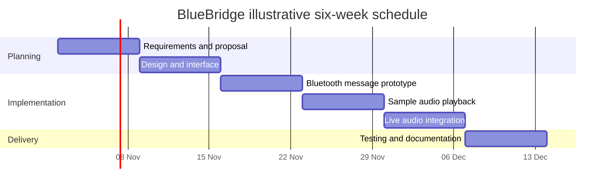
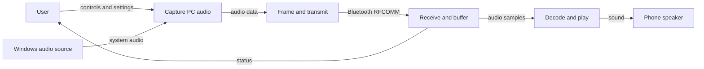
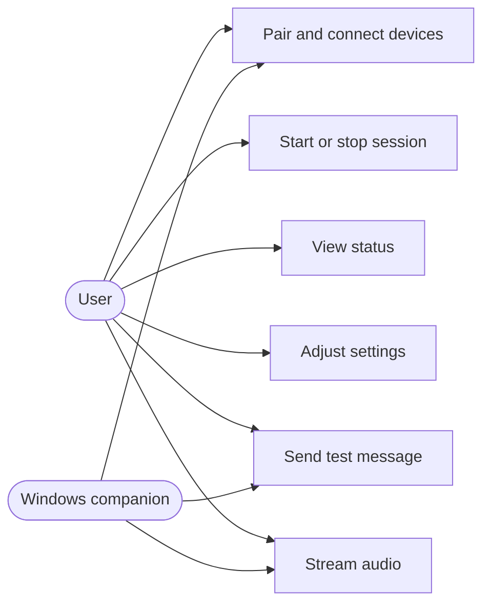
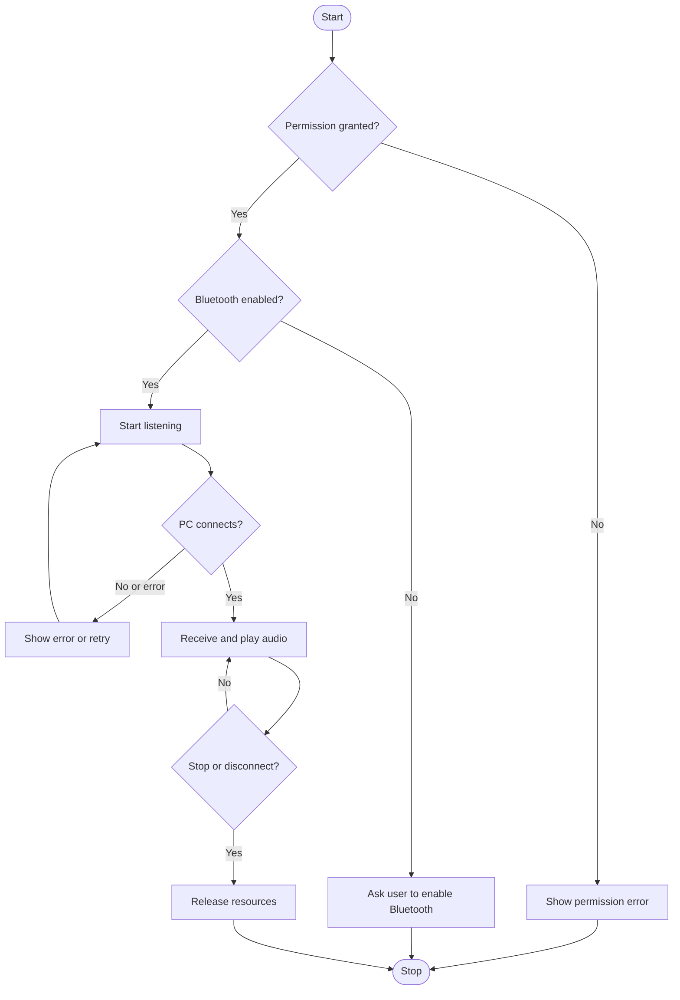
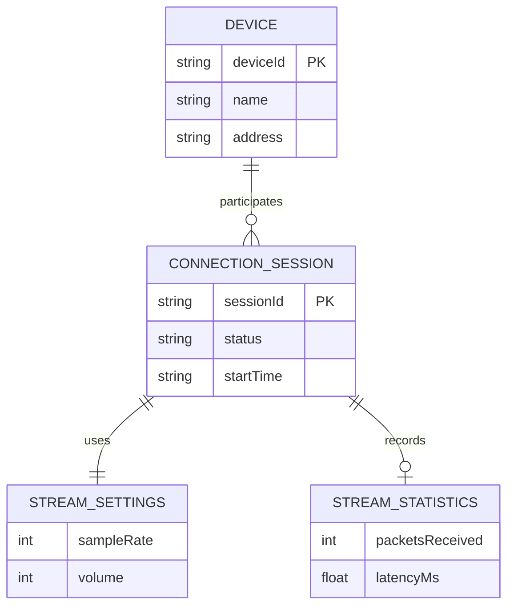
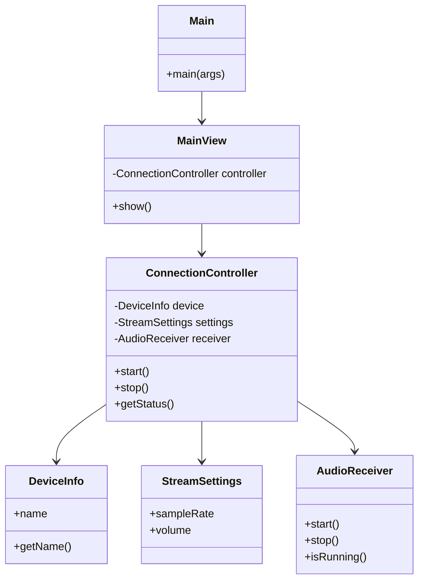
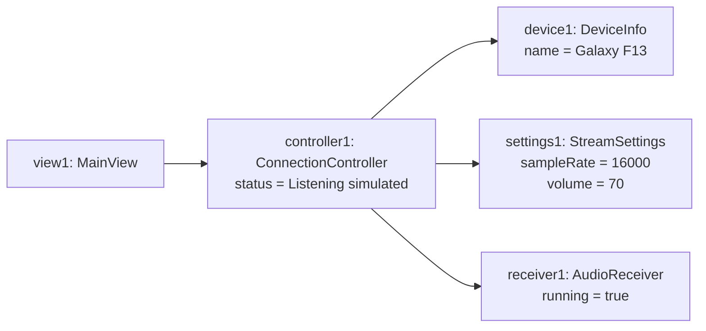

# BlueBridge: Bluetooth-Based PC-to-Android Audio Streaming

**Individual project proposal**  
**Student:** Shahrier Mokammel Shafeen | **Roll:** IT24050 | **Department:** ICT, MBSTU  
**Status:** Initial proposal and Java interface prototype

## 1. Executive summary
BlueBridge proposes a Windows companion and Android application that stream PC audio to an Android phone over Bluetooth Classic. The Windows application will capture system audio and send framed audio data through an authenticated RFCOMM connection. The Android application will receive and play it. The included Java Swing interface simulates the workflow using six classes; it does not perform Bluetooth communication or audio streaming. Feasibility and performance remain to be tested.

## 2. Problem and motivation
A phone normally sends Bluetooth audio rather than serving as a general-purpose Bluetooth speaker for Windows. BlueBridge explores a custom app-to-app connection so an existing Android phone can act as an audio output device without Wi-Fi, internet, root, or USB during normal operation.

## 3. Objectives and scope
- Create a clear interface to start and stop a connection and adjust stream settings.
- Build a paired, authenticated Bluetooth RFCOMM connection and exchange a test message.
- Capture PC system audio, transport framed audio data, and play it on the phone.
- Measure latency, dropouts, and reconnection behavior on the target devices.

**In scope:** Windows 11 and Android; one phone; offline operation. **Out of scope:** iOS, multi-device playback, universal Bluetooth speaker support, and guaranteed low latency. Target devices: Windows Bluetooth-enabled PC and Samsung Galaxy F13.

## 4. Stakeholders and requirements
**Stakeholders:** student developer, PC/phone user, course instructor.  
**Functional:** FR1 check Bluetooth and permissions; FR2 listen and connect to paired device; FR3 show connection status and errors; FR4 exchange a test message; FR5 capture and transmit audio; FR6 buffer/play audio; FR7 change settings and stop.  
**Non-functional:** simple controls; authenticated paired connection; graceful disconnection; measurable audio latency; modular maintainable code; no internet for operation.

## 5. Proposed architecture and tools
Windows C#/.NET: WASAPI loopback capture → optional encoding → RFCOMM client. Android Java: RFCOMM server → frame receiver → buffer/decoder → AudioTrack playback. Android Studio, .NET, Git and GitHub are proposed. The included Java Swing program is a desktop demonstration of the interface and object interactions, not the Android implementation. RFCOMM is not the A2DP audio profile. Raw 16 kHz/16-bit mono PCM (~256 kbps) is an initial experiment; throughput, latency and reliability must be measured.

## 6. Process model
**Iterative and incremental development:** build a small UI, validate Bluetooth text transfer, then test audio samples and live streaming. Each iteration delivers a working increment and feedback; difficult Bluetooth throughput questions are tested early before committing to full streaming.

## 7. Schedule, milestones and deliverables
The six-week schedule is illustrative, starting after proposal approval.

| Week | Work | Milestone / deliverable |
|---|---|---|
| 1 | Requirements and feasibility | M1: scope and initial proposal |
| 2 | Architecture, diagrams and UI | M2: design and interface prototype |
| 3 | RFCOMM server and client | M3: paired test-message exchange |
| 4 | Framed audio and playback | M4: sample audio prototype |
| 5 | Capture and streaming integration | M5: live audio integration attempt |
| 6 | Test, fix and document | M6: test report and final GitHub release |

Dependencies: design follows requirements; Bluetooth text exchange precedes audio transfer; sample audio precedes live integration; final testing follows implementation.



## 8. Data Flow Diagram (DFD)


## 9. Use Case Diagram


## 10. Activity Diagram


## 11. Entity Relationship Diagram
Conceptual in-memory model only; no database is implemented or required.


## 12. Class Diagram
The six classes below are implemented in the included desktop interface. Real Android and Windows components are planned separately.


## 13. Object Diagram
A sample runtime snapshot after the user clicks Start; these are prototype objects and values.


## 14. Testing and acceptance plan
| Test | Expected result | Status |
|---|---|---|
| Prototype Start/Stop | Status changes and controls respond | Included; run locally to verify |
| Volume setting | Interface displays selected volume | Included; run locally to verify |
| Bluetooth permission denied | Clear error and safe recovery | Planned |
| Paired RFCOMM message | PC message received on phone | Planned |
| Audio and reconnect | Playback, disconnect/reconnect, measured latency | Planned |

## 15. Risks and mitigation
| Risk | Mitigation |
|---|---|
| RFCOMM throughput or latency inadequate | Test text first, then low-rate mono audio; measure dropouts and consider compression. |
| Permissions or device differences | Test on target Android and Windows versions; handle denied permissions. |
| Disconnects and resource leaks | Close sockets and audio resources safely; add retry and test logs. |
| Time constraints | Deliver interface and design first, then incrementally add functionality. |

## 16. Current implementation and running
This repository contains a **simulated Java desktop UI**, not the final Android/Windows application. Start changes the simulated state, Stop resets it, and volume updates settings. No Bluetooth connection, real playback, Android permissions or streaming has been implemented or verified.

Run with JDK 8 or later:
```bash
javac -d out src/*.java
java -cp out Main
```
In IntelliJ, open the folder as a project, open `src/Main.java`, and run `main()`. No third-party dependencies are needed. Take a real screenshot after running it and add it to your repository if required.

## 17. Future deliverables
Android app and Windows companion source; verified message exchange; audio prototype; test results and screenshots; updated documentation. Actual implementation results will be recorded rather than assumed.
